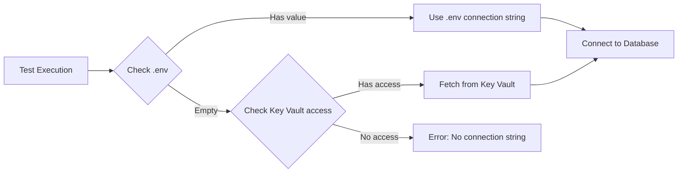

# Local Database Testing Setup Guide

## Problem
You need database connection strings for local testing, but don't have access to Azure Key Vault.

## Solution
Get the connection strings from someone who has Key Vault access and paste them into your `.env` file.

## Step 1: Get Connection Strings

### Option A: Ask Admin to Run These Commands
Someone with Key Vault access needs to run:

```bash
# Get Transfer connection string
az keyvault secret show --vault-name amkkvqapipeline-testncus --name "transfer-connection-string" --query "value" -o tsv

# Get Account Distributions connection string
az keyvault secret show --vault-name amkkvqapipeline-testncus --name "accoundistributions-connection-string" --query "value" -o tsv

# Get CRM connection string
az keyvault secret show --vault-name amkkvqapipeline-testncus --name "crm-db-connection-string" --query "value" -o tsv

# Get Billing connection string
az keyvault secret show --vault-name amkkvqapipeline-testncus --name "am-billing-connection-string" --query "value" -o tsv
```

### Option B: Via Azure Portal
1. Go to: https://portal.azure.com
2. Navigate to: **amkkvqapipeline-testncus** Key Vault
3. Click **Secrets** in left menu
4. Click each secret name and copy the **Secret Value**

### Option C: From Azure DevOps Pipeline Run
1. Find a successful pipeline run
2. Look for the "Fetch Secrets from Azure Key Vault" task
3. The secrets are used but not displayed (security)
4. Contact the pipeline admin

## Step 2: Update .env File

Open `.env` and replace the template values:

```bash
# Before (template):
TRANSFER_CONNECTION_STRING=Server=your-transfer-server.database.windows.net;Database=Transfer;UID=your-username;PWD=your-password;...

# After (actual value):
TRANSFER_CONNECTION_STRING=Server=sqlwfitest.database.windows.net;Database=Transfer;UID=ishan.mehta@assetmark.com;PWD=ActualPassword123;Encrypt=yes;TrustServerCertificate=no;Connection Timeout=30;
```

## Step 3: Test Connection

Run this to verify your connection strings work:

```powershell
# Test database connection
python -c "from utils.database import get_db_from_vault; db = get_db_from_vault('transfer'); print('✓ Transfer DB connected')"

python -c "from utils.database import get_db_from_vault; db = get_db_from_vault('crm'); print('✓ CRM DB connected')"
```

## Step 4: Run Database Tests

```powershell
# Run all database tests
pytest tests/bdd/test_runners/test_vault_database.py -v

# Run specific test
pytest tests/bdd/test_runners/test_vault_database.py::test_transfer_audit_query -v
```

## Security Notes

### ✅ DO:
- Keep `.env` file private (already in .gitignore)
- Never commit `.env` to Git
- Request only TEST environment credentials
- Use read-only database accounts if available

### ❌ DON'T:
- Share your `.env` file with others
- Commit connection strings to the repo
- Use production database credentials locally
- Copy connection strings to Slack/email

## Connection String Formats

### Azure SQL Database (with Azure AD):
```
Server=<server>.database.windows.net;Database=<db>;UID=<email>;PWD=<password>;Authentication=ActiveDirectoryPassword;Encrypt=yes;TrustServerCertificate=no;Connection Timeout=30;
```

### Azure SQL Database (with SQL Authentication):
```
Server=<server>.database.windows.net;Database=<db>;UID=<username>;PWD=<password>;Encrypt=yes;TrustServerCertificate=no;Connection Timeout=30;
```

### SQL Server (Windows Authentication - local):
```
Server=<server>;Database=<db>;Trusted_Connection=yes;
```

## Troubleshooting

### "Connection string not found"
- Check `.env` file has actual values, not placeholders
- Ensure no extra spaces or line breaks in connection string
- Restart VS Code or reload terminal after updating `.env`

### "Login failed for user"
- Verify username/password are correct
- Check if your IP is whitelisted in Azure SQL firewall
- Confirm you're using correct authentication method

### "Cannot open database"
- Database name is case-sensitive
- Ensure you have access to that specific database
- Check if database exists in that server

## Request Key Vault Access (Better Long-term Solution)

To avoid manually managing connection strings, request Key Vault access:

**Send this to your Azure Admin:**

> Hi [Admin Name],
>
> Could you please grant me **"Key Vault Secrets User"** role on the `amkkvqapipeline-testncus` Key Vault?
>
> This will allow me to fetch database connection strings locally using `az login`, matching how our CI/CD pipeline works.
>
> Role: **Key Vault Secrets User**
> Scope: `/subscriptions/9156b16c-8a2e-4b7d-a886-e772dc017316/resourcegroups/rg-aks-infra-test01-ncus/providers/microsoft.keyvault/vaults/amkkvqapipeline-testncus`
> User: `your.email@assetmark.com`
>
> Command:
> ```bash
> az role assignment create \
>   --role "Key Vault Secrets User" \
>   --assignee your.email@assetmark.com \
>   --scope /subscriptions/9156b16c-8a2e-4b7d-a886-e772dc017316/resourcegroups/rg-aks-infra-test01-ncus/providers/microsoft.keyvault/vaults/amkkvqapipeline-testncus
> ```

Once granted, your framework will automatically fetch secrets without needing `.env` values!

## How It Works



Priority: `.env` → Key Vault → Error

## Related Files

- [.env](./.env) - Environment variables (connection strings here)
- [config/env.test11.yaml](../config/env.test11.yaml) - Database config definitions
- [utils/database.py](../utils/database.py) - Database connection logic
- [utils/azure_key_vault.py](../utils/azure_key_vault.py) - Key Vault client
- [docs/AZURE_KEY_VAULT_GUIDE.md](./AZURE_KEY_VAULT_GUIDE.md) - Complete Key Vault guide
