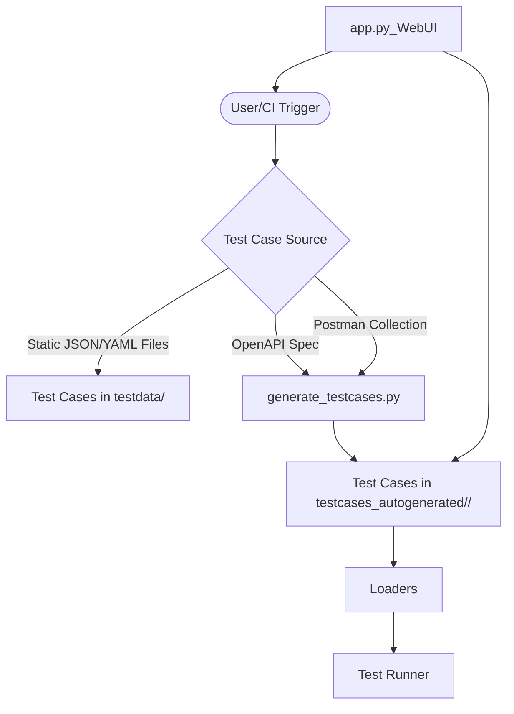
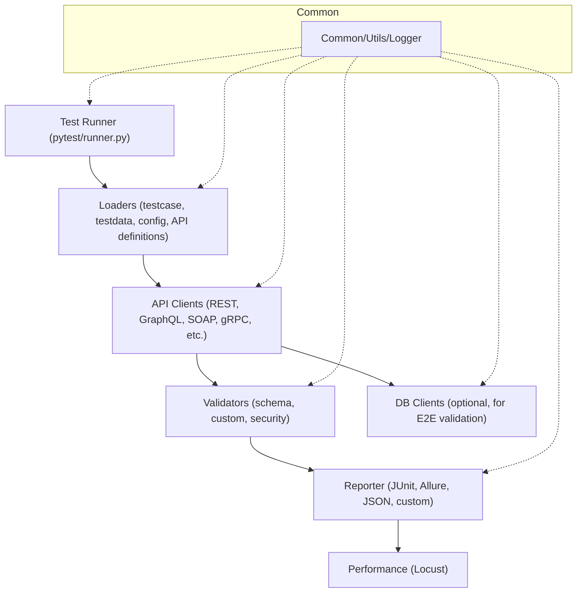
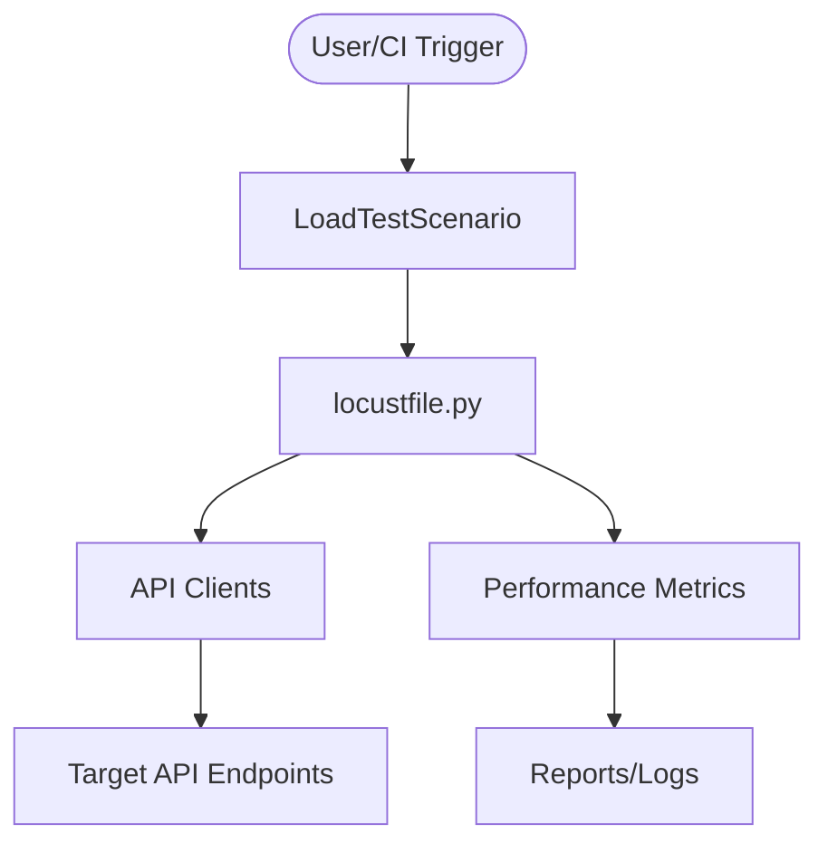

# CoreAPI Automation Framework - README

## Overview
The CoreAPI Automation Framework is a modular, extensible Python-based solution for API testing, validation, reporting, and performance analysis. It supports a wide range of protocols, test strategies, and data management approaches, making it suitable for both simple and complex API automation needs.

**This README is focused on practical usage, onboarding, and feature explanations.**

For technical architecture, design rationale, and extensibility details, see the [ARCHITECTURE.md](./ARCHITECTURE.md) file.

## 📋 Quick Links

- **[Pipeline Matrix Documentation](docs/PIPELINE_MATRIX_USAGE.md)** - Matrix-based CI/CD pipeline guide
- **[Architecture Documentation](docs/ARCHITECTURE.md)** - Technical architecture and design
- **[Framework Flow](docs/FRAMEWORK_FLOW.md)** - Detailed execution flow
- **[Performance Testing](docs/PERFORMANCE.md)** - Load testing guide

---

## Features

### Testing Capabilities
- **Multi-protocol support**: REST, GraphQL, SOAP, gRPC, and more
- **Database integration**: MSSQL, PostgreSQL, MongoDB, CosmosDB, SQLite, InfluxDB with Azure AD authentication support
- **Static and dynamic test case management**: OpenAPI/Swagger/Postman imports with auto-generation
- **Data-driven and hybrid testing**: CSV-based test data with Jinja2 templating
- **Modular test execution**: Pluggable test_helpers modules for separation of concerns
- **Rich reporting**: Allure, JUnit, JSON, HTML, email notifications, and custom reports
- **Performance/load testing**: Built-in Locust integration with framework clients, validators, and automatic report archiving
- **Real-time monitoring**: Azure Log Analytics integration for centralized metrics and Grafana visualization; InfluxDB support for time-series metrics
- **Security scanning**: Bandit and Safety integration for vulnerability detection

### CI/CD Integration
- **Matrix-based Azure Pipeline**: Dynamic service and environment execution
- **Flexible triggers**: PR validation, push automation, scheduled runs, manual execution
- **Parallel execution**: Run multiple service-environment combinations concurrently
- **Centralized configuration**: Service matrix configuration in YAML
- **CLI management tool**: Easy service and trigger management via `manage_matrix.py`

### Architecture
- **Modular, pluggable design**: Easy extension for new protocols, validators, and reporters
- **Centralized configuration**: Environment-specific configs with multiple API endpoints and DB connections
- **Azure AD authentication**: Passwordless authentication for PostgreSQL and Azure APIs
- **Optional AI/LLM integration**: For test generation and validation

---

## CI/CD Pipeline - Matrix-Based Execution

This framework uses a sophisticated matrix-based pipeline that dynamically executes tests based on service configuration. See [docs/PIPELINE_MATRIX_USAGE.md](docs/PIPELINE_MATRIX_USAGE.md) for complete details.

### Quick Start

**View current configuration:**
```bash
python scripts/manage_matrix.py list
python scripts/manage_matrix.py summary
```

**Enable a service for testing:**
```bash
# Enable all flags at once
python scripts/manage_matrix.py set-all-flags parties true

# Or set specific flags
python scripts/manage_matrix.py set-all-flags movemoney \
  --enabled true \
  --run-on-pr true \
  --run-on-push true \
  --run-on-schedule false
```

**Test configuration locally:**
```bash
# Simulate what would run on a PR
python scripts/manage_matrix.py simulate-pr --env TSADEV

# Validate configuration
python scripts/manage_matrix.py validate
```

### Pipeline Features

- ✅ **Automatic PR validation** - Runs critical services on pull requests
- ✅ **Push-based CI** - Executes on code commits
- ✅ **Scheduled regression** - Cron-based comprehensive testing
- ✅ **Manual execution** - On-demand runs with custom parameters
- ✅ **Multi-environment** - TSADEV, TSATEST, T12, T11, T10
- ✅ **Parallel jobs** - Up to 5 concurrent service-environment combinations
- ✅ **Dynamic matrix** - Auto-generated from configuration

See the [Pipeline Matrix Documentation](docs/PIPELINE_MATRIX_USAGE.md) for comprehensive usage guide.

---

## Getting Started
1. **Install dependencies:**
   ```sh
   pip install -r requirements.txt
   ```
2. **Configure environments:**
   - Edit config files in `config/` and set up your `.env` file.
3. **Add or generate test cases:**
   - Place static test cases in `testdata/`.
   - Use the generator script to create test cases in the `testcases_autogenerated/` folder (by default, organized by API/spec name). Then move the files to `testdata/` manually.
4. **Run tests:**
   - Use pytest CLI or Azure Pipeline integration.
   - See below for command variations.
5. **View reports:**
   - Check the `reports/` directory.
6. **Test Management:**
   - (Dashboard UI is deprecated or not included in this version.)
---

## Usage Flows

### Test Case Generation Flow

### Test Execution Flow


**Legend:**
- All modules are extensible and modular. Add new protocols, DBs, or validators as needed.
- AI augmentation (LLMs) can be integrated for test generation, anomaly detection, or smart validation.


### Locust Performance Flow


---

## Example Test Case (JSON)
```json
{
    "test_id": "TC001",
    "api_type": "REST|GraphQL|SOAP|RPC",
    "endpoint": "/users",
    "method": "GET|POST|PUT|DELETE",
    "graphql_query": "",
    "soap_action": "",
    "rpc_method": "",
    "headers": {},
    "payload": {},
    "expected_status": 200,
    "expected_response": {},
    "db_query": "SELECT * FROM users WHERE id = {{user_id}}",
    "db_type": "mssql|postgres|cosmosdb|mongodb",
    "extract_values": [],
    "validate": {
        "performance": {"max_response_time_ms": 500},
        "security": {"checks": ["sql_injection", "xss"]},
        "data_comparison": {
            "source": "api_response",
            "target": "db_result",
            "key_field": ["user_id"],
            "fields_to_compare": ["email", "name"]
        }
    }
}
```

---

## Directory Structure
- `framework/` - Core logic
  - `clients/` - API and database clients
    - `api_client.py` - REST API client with multi-endpoint support
    - `graphql_client.py` - GraphQL query/mutation client
    - `soap_client.py` - SOAP/WSDL service client
    - `grpc_client.py` - gRPC protocol client
    - `db_client.py` - Unified database client (MSSQL, PostgreSQL, MongoDB, CosmosDB, SQLite, InfluxDB)
    - `azure_auth.py` - Azure AD authentication for passwordless access
  - `test_helpers/` - Modular test execution managers
    - `test_case_loader.py` - Load and filter test cases
    - `test_client_manager.py` - Manage API clients
    - `test_context_manager.py` - Handle test context and variables
    - `test_db_manager.py` - Database operations and validation
    - `test_payload_manager.py` - Payload preparation and templating
    - `test_result_collector.py` - Collect and organize test results
    - `test_validation_manager.py` - Response validation and assertions
  - `loaders/` - Configuration and data loaders
    - `config_loader.py` - Environment-specific YAML configuration management
    - `testcase_loader.py` - Test case JSON/YAML loading
    - `testdata_loader.py` - Data-driven test data loading
    - `path_loader.py` - Project path resolution
    - `api_definitions_loader.py` - OpenAPI/Swagger/Postman definitions
  - `validators/` - Response validators
    - `validators.py` - Status code, JSON schema, field, and DB comparison validators
  - `reporter/` - Reporting utilities
    - `reporter.py` - Multi-format report generation (Allure, JUnit, JSON, HTML)
    - `influx_reporter.py` - InfluxDB time-series metrics reporting
    - `log_analytics_reporter.py` - Azure Log Analytics integration with HTTP Data Collector API
    - `email_reporter.py` - Email notification for test results
  - `common/` - Shared utilities and logger
    - `logger.py` - Centralized logging configuration
    - `utils.py` - Common utility functions
    - `template_utils.py` - Jinja2 template rendering
    - `common_functions.py` - Shared helper functions
  - `runner.py` - Test execution orchestrator
  - `generate_testcases.py` - Test case generation from OpenAPI/Swagger/Postman
  - `generate_testcases.py` - Generate tests from OpenAPI/Swagger/Postman
- `tests/` - Test runners and pytest integration
- `testdata/` - Test cases and data files
- `config/` - Environment and framework configuration
- `reports/` - Test reports and logs
- `templates/` - Test case templates and documentation
- `locustfile.py` - Performance/load testing

---

## Contributing
- Follow modular design principles and add new features as separate modules.
- Write docstrings and comments for all public functions/classes.
- Update `requirements.txt` and documentation as needed.

---

## License

---

## Test Execution Command Variations

You can run tests with different test case files and data-driven scenarios using the following commands:

**Basic execution:**
```sh
pytest -s tests/test_api_generic.py --testcase-file testdata/WorkItemNotification/testcases/TestCase_api_workitemnotification_v1_preferences_workitems_visibility_POST.json
```

**Run with a different test case file:**
```sh
pytest -s tests/test_api_generic.py --testcase-file testdata/UserService/testcases/TestCase_users_POST.json
```

**Run with data-driven input:**
```sh
pytest -s tests/test_api_generic.py --testcase-file testdata/WorkItemNotification/testcases/TestCase_api_workitemnotification_v1_preferences_workitems_visibility_POST.json --data-file testdata/WorkItemNotification/data_driven/TestData_input.csv
```

**Run all tests in the folder:**
```sh
pytest -s tests/
```

**Run with custom markers or environment:**
```sh
pytest -s tests/test_api_generic.py --testcase-file testdata/WorkItemNotification/testcases/TestCase_api_workitemnotification_v1_preferences_workitems_visibility_POST.json -m "smoke"
pytest -s tests/test_api_generic.py --testcase-file testdata/WorkItemNotification/testcases/TestCase_api_workitemnotification_v1_preferences_workitems_visibility_POST.json --env T10
```


---

## Test Case Generation Command Variations

You can generate test cases from different sources using the generator script:


**From OpenAPI spec (local file):**
```sh
python -m framework.generate_testcases openapi apiSpecs/userManagementAPI.yaml testcases_autogenerated/userManagementAPI/
```

**From OpenAPI spec (URL):**
```sh
python -m framework.generate_testcases openapi https://raw.githubusercontent.com/example/repo/main/openapi.yaml testcases_autogenerated/userManagementAPI/
```

**From Postman collection:**
```sh
python -m framework.generate_testcases postman apiSpecs/UserCollection.postman_collection.json testcases_autogenerated/UserCollection/
```

**From local folder of static files:**
```sh
python -m framework.generate_testcases folder testdata/WorkItemNotification/testcases/ testcases_autogenerated/WorkItemNotification/
```

**General usage:**
```sh
python -m framework.generate_testcases --help
```

After generation, move or review the files in `testcases_autogenerated/<API or Spec Name>/` as needed.


---
## API Specs Usage
- Place your API definition files (OpenAPI, WSDL, Postman collections, etc.) in the [apiSpecs](http://_vscodecontentref_/7) folder.
- This folder is not tracked in git; each user should add their own specs as needed.
- Example files: [userManagementAPI.yaml](http://_vscodecontentref_/8), `CalculatorService.wsdl`, `UserCollection.postman_collection.json`

---
**Logging in conftest.py:**
- You can also configure logging in `conftest.py` using Python's `logging` module. For example:
   ```python
   import logging
   def pytest_configure(config):
         logging.basicConfig(level=logging.INFO, format='%(levelname)s:%(name)s:%(message)s')
   ```
- Logging settings in `conftest.py` may override or supplement those in `pytest.ini`.
- For full suppression, ensure both `pytest.ini` and `conftest.py` are set appropriately and avoid direct `print()` statements.

---

## Database Connectivity

### Supported Database Clients

The framework provides unified database client support through `DatabaseClientFactory`:

**Supported databases:**
- **MSSQL** - Microsoft SQL Server
- **PostgreSQL** - With Azure AD passwordless authentication support
- **SQLite** - Lightweight embedded database
- **MongoDB** - NoSQL document database
- **CosmosDB** - Azure managed NoSQL database
- **InfluxDB** - Time-series database for metrics and monitoring

### PostgreSQL Connection Helper

A helper function for PostgreSQL connections is available in `framework/clients/db_client.py`:

```python
from framework.clients.db_client import create_postgres_connection

conn = create_postgres_connection()  # Picks up environment config as per .env file. Example in .env file, if ENV_NAME=TSADEV then it uses config/config.TSADEV.yaml 
```
- The function reads connection details from the YAML config file. 

```python
conn = create_postgres_connection(config_path=<Pick based on config loader>)
```
- Returns a psycopg2 connection object for use in tests and scripts.

### Database Client Factory Usage

```python
from framework.clients.db_client import DatabaseClientFactory

# Get specific database client from config
db_client = DatabaseClientFactory.get_client('postgres', 'default', auto_connect=True)
results = db_client.execute_query("SELECT * FROM users")

# InfluxDB client for metrics
influx_client = DatabaseClientFactory.get_client('influxdb', 'default', auto_connect=True)
influx_client.write_point(point)  # Write single metric
influx_client.write_points(points)  # Batch write metrics
```

---

## Azure Log Analytics Integration

The framework automatically pushes aggregated test results to Azure Log Analytics for monitoring and visualization in Grafana dashboards.

### Overview

Test results are pushed to Log Analytics using the HTTP Data Collector API with Shared Key authentication. A single custom table is created automatically:

- **TestResults_CL** - Aggregated test metrics per pipeline run (pass rate, failed tests, total tests, timing, validation statistics)

### Configuration

The following variables must be configured in your Azure DevOps variable group (e.g., `qa-pipelines-shared-config`):

```yaml
# Required
logAnalyticsWorkspaceId: "<your-workspace-id-guid>"
logAnalyticsSharedKey: "<your-primary-or-secondary-shared-key>"  # Mark as secret

# Optional
logAnalyticsEnabled: "true"  # Set to "false" to disable (default: true)
```

**How to get credentials:**
1. Azure Portal → Log Analytics workspaces → Select your workspace
2. Settings → Agents
3. Copy **Workspace ID** and **Primary key**

### Usage

The Log Analytics reporter runs automatically in the Azure Pipeline after test execution:

```yaml
- task: Bash@3
  displayName: 'Push to Log Analytics'
  env:
    LOG_ANALYTICS_WORKSPACE_ID: $(logAnalyticsWorkspaceId)
    LOG_ANALYTICS_SHARED_KEY: $(logAnalyticsSharedKey)
    LOG_ANALYTICS_ENABLED: $(logAnalyticsEnabled)
  script: |
    python3 framework/reporter/log_analytics_reporter.py
```

**Standalone usage:**
```bash
# Push aggregated test metrics
export LOG_ANALYTICS_WORKSPACE_ID="<workspace-id>"
export LOG_ANALYTICS_SHARED_KEY="<shared-key>"
export LOG_ANALYTICS_ENABLED="true"
python framework/reporter/log_analytics_reporter.py
```

### Data Schema

**TestResults_CL:**
- **Pipeline Info**: BuildId, BuildNumber, PipelineId, PipelineName, RunTimestamp
- **Environment**: Environment, ServiceName
- **Test Metrics**: TotalTests, PassedTests, FailedTests, SkippedTests, PassRate
- **Performance**: Duration, AvgResponseTime, StartTime, EndTime
- **Failed Tests**: FailedTestNames (comma-separated, max 10), FailedTestCount
- **Validation Statistics** (aggregated across all tests):
  - StatusCodeChecks: Total, Passed, Failed
  - Assertions: Total, Passed, Failed
  - ContractChecks: Total, Passed, Failed
  - SecurityChecks: Total, Passed, Failed
  - PerformanceChecks: Total, Passed, Failed

### Grafana Dashboard Queries

Query examples for Grafana dashboards using KQL (Kusto Query Language):

#### 1. Pass Rate Over Time
```kql
TestResults_CL
| where TimeGenerated > ago(7d)
| project TimeGenerated, PassRate_d, ServiceName_s, BuildNumber_s, TotalTests_d
| order by TimeGenerated asc
```

**Visualization**: Time series chart
- X-axis: TimeGenerated
- Y-axis: PassRate_d
- Group by: ServiceName_s (optional)

#### 2. Failed Tests Per Build
```kql
TestResults_CL
| where TimeGenerated > ago(30d)
| project TimeGenerated, BuildNumber_s, FailedTests_d, ServiceName_s, FailedTestNames_s
| order by FailedTests_d desc
```

**Visualization**: Bar chart or table
- X-axis: BuildNumber_s
- Y-axis: FailedTests_d
- Color by: ServiceName_s (optional)

#### 3. Total Tests Per Pipeline
```kql
TestResults_CL
| where TimeGenerated > ago(30d)
| summarize TotalTestsRun = sum(TotalTests_d), Builds = count() by PipelineName_s, ServiceName_s
| project PipelineName_s, ServiceName_s, TotalTestsRun, Builds, AvgTestsPerBuild = TotalTestsRun / Builds
| order by TotalTestsRun desc
```

**Visualization**: Table or bar chart
- Shows total tests executed per pipeline/service over the time period
- Includes average tests per build

#### Bonus: Service Health Dashboard
```kql
TestResults_CL
| where TimeGenerated > ago(24h)
| summarize 
    TotalRuns = count(),
    AvgPassRate = avg(PassRate_d),
    TotalFailures = sum(FailedTests_d),
    LatestBuild = max(BuildNumber_s)
  by ServiceName_s
| extend HealthStatus = case(
    AvgPassRate >= 95, "Healthy",
    AvgPassRate >= 80, "Warning",
    "Critical"
  )
| order by AvgPassRate asc
```

#### Trend Analysis: Pass Rate Trend (Last 7 Days)
```kql
TestResults_CL
| where TimeGenerated > ago(7d)
| summarize AvgPassRate = avg(PassRate_d) by ServiceName_s, bin(TimeGenerated, 12h)
| render timechart
```

### Grafana Dashboard Setup

1. **Add Azure Monitor Data Source** in Grafana
   - Configuration → Data Sources → Add Azure Monitor
   - Select your Log Analytics workspace
   
2. **Create Dashboard Panels**:
   - Panel 1: "Pass Rate Over Time" (Line chart)
   - Panel 2: "Failed Tests Per Build" (Bar chart)
   - Panel 3: "Total Tests Per Pipeline" (Table)
   - Panel 4: "Service Health Status" (Stat panel with thresholds)

3. **Set Refresh Interval**: 5-15 minutes (to match Log Analytics ingestion latency)

**Note:** Custom tables may take 5-15 minutes to appear in Log Analytics after the first write.

---

## Performance Testing and Monitoring

For comprehensive documentation on performance testing with Locust, InfluxDB integration, and Grafana monitoring, see:

📖 **[Performance_README.md](./Performance_README.md)**

---

Adjust file paths and options as needed for your scenario.

---

This project is licensed under the MIT License.
