# API Automation Framework - Complete Flow Guide

**A Comprehensive Guide for Beginners**

---

## Table of Contents
1. [Framework Overview](#framework-overview)
2. [High-Level Architecture](#high-level-architecture)
3. [Execution Flows](#execution-flows)
   - [Test Case Generation Flow](#test-case-generation-flow)
   - [Test Execution Flow (Pytest)](#test-execution-flow-pytest)
   - [Locust Performance Test Flow](#locust-performance-test-flow)
4. [Test Execution Flow Details](#test-execution-flow-details)
5. [Component Details](#component-details)
6. [Database Integration](#database-integration)
7. [Validation Pipeline](#validation-pipeline)
8. [File Structure](#file-structure)

---

## Framework Overview

This is a **data-driven, multi-protocol API testing framework** built with pytest that supports:
- REST, GraphQL, gRPC, SOAP, and Database-only testing
- Data-driven testing with CSV/JSON/YAML
- Multi-environment configuration
- Database validation (MSSQL, PostgreSQL, MongoDB, CosmosDB, SQLite, InfluxDB)
- Performance testing with Locust
- Comprehensive validation (status, schema, fields, response matching)
- HTML, JSON, JUnit, and Allure reporting

---

## High-Level Architecture

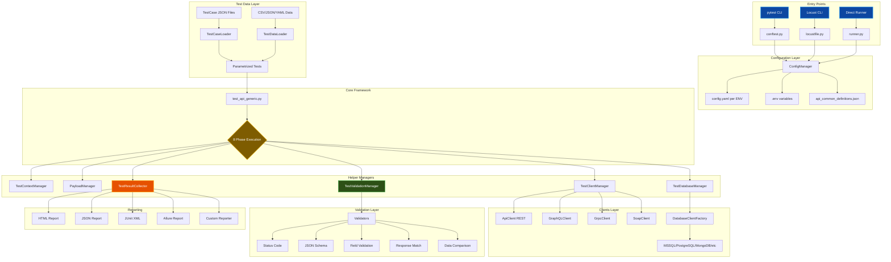

---

## Execution Flows

### Test Case Generation Flow

**Entry Point**: `python framework/generate_testcases.py`

**Key Files**:
- Input: `templates/TestCase_Template.json`
- Input: `framework/api_common_definitions.json`
- Output: `testdata/<service>/testcases/TestCase_<service>_<endpoint>_<method>.json`

**Exit Points**: 
- Generated test case JSON files in `testdata/<service>/testcases/`
- Console output with generation summary

```mermaid
flowchart TD
    A["⚡ ENTRY: python framework/generate_testcases.py<br/>📂 Working Dir: core-api-automation/"] --> B["📄 Load templates/TestCase_Template.json"]
    B --> C["📄 Load framework/api_common_definitions.json"]
    C --> D["🔍 Parse API definitions for service<br/>(e.g., parties, WorkItemNotification)"]
    
    D --> E{Multiple endpoints?}
    E -->|Yes| F["🔄 For each endpoint"]
    E -->|No| G["📝 Single endpoint"]
    
    F --> H["⚙️ Generate test case structure"]
    G --> H
    
    H --> I["Set test_id: TC001, TC002...<br/>Set service_name: parties<br/>Set endpoint: /parties/ID"]
    I --> J["Set method: GET/POST/PUT/DELETE"]
    J --> K["Add expected_status: 200/201/400"]
    K --> L["Add payload template if POST/PUT<br/>📄 Ref: testdata/service/payloads/Payload_*.json"]
    L --> M["Add validation config:<br/>- expected_response_schema<br/>- ignore_fields<br/>- data_comparison"]
    M --> N["Add test_data_file reference<br/>📄 testdata/service/data_driven/Data_*.csv"]
    N --> O["Add db_query config if needed<br/>📄 testdata/service/db_queries/Query_*.sql"]
    
    O --> P{More endpoints?}
    P -->|Yes| F
    P -->|No| Q["📦 Combine all test cases into JSON array"]
    
    Q --> R["💾 Write to:<br/>📂 testdata/parties/testcases/<br/>📄 TestCase_parties_GET.json<br/>📄 TestCase_parties_POST.json<br/>📄 TestCase_parties_PUT.json"]
    R --> S["✅ EXIT:<br/>✔️ Generated 3 test case files<br/>✔️ Console summary printed"]
    
    T["👤 User manual review and edit<br/>Update test_data_file paths<br/>Add expected responses"] --> S
    R --> T
    
    style A fill:#2d5016,stroke:#4caf50,stroke-width:3px,color:#fff
    style S fill:#0d47a1,stroke:#2196f3,stroke-width:3px,color:#fff
    style R fill:#7e5c00,stroke:#ffc107,stroke-width:2px,color:#fff
    style B fill:#1a237e,stroke:#3f51b5,stroke-width:2px,color:#fff
    style C fill:#1a237e,stroke:#3f51b5,stroke-width:2px,color:#fff
```

**Command Example**:
```bash
python framework/generate_testcases.py --service parties --api-def api_common_definitions.json
```

---

### Test Execution Flow (Pytest)

**Entry Point**: `pytest tests/test_api_generic.py --env <ENV>`

**Key Files**:
- Entry: `tests/test_api_generic.py` (main test file)
- Config: `conftest.py` (pytest hooks and fixtures)
- Config: `config/config.<ENV>.yaml` (environment-specific settings)
- Input: `testdata/<service>/testcases/TestCase_*.json`
- Input: `testdata/<service>/data_driven/Data_*.csv`
- Logs: `framework/logs/test_execution_<timestamp>.log`
- Output: `reports/<timestamp>/pytest_report_<timestamp>.html`

**Exit Points**: 
- Test results (Pass/Fail) in terminal
- HTML report in `reports/<timestamp>/pytest_report_*.html`
- JSON report in `reports/<timestamp>/json_report_*.json`
- JUnit XML in `reports/<timestamp>/junit_report_*.xml`

```mermaid
flowchart TD
    A["⚡ ENTRY: pytest tests/test_api_generic.py<br/>--env T12 --test-id TC001<br/>📂 Working Dir: core-api-automation/"] --> B["📄 conftest.py: pytest_configure hook"]
    B --> C["⚙️ Set ENV_NAME='T12' from --env"]
    C --> D["📄 Load config/config.T12.yaml<br/>Get api_base_url, db_connections, services"]
    D --> E["📝 Initialize logger<br/>📂 Output: framework/logs/test_*.log"]
    E --> F["🔧 pytest_generate_tests hook<br/>📄 In: tests/test_api_generic.py"]
    
    F --> G["📦 TestCaseLoader.load_and_filter_cases()<br/>📂 From: framework/test_helpers/"]
    G --> H{"🔍 Filters applied?"}
    H -->|--test-id| I["Filter by test_id=TC001"]
    H -->|--service-name| J["Filter by service_name=parties"]
    H -->|--testcase-file| K["📄 Load specific file path"]
    H -->|None| L["📂 Load all from testdata/service/testcases/*.json<br/>Glob pattern: testcases/TestCase_*.json"]
    
    I --> M["📄 Load test_data from CSV<br/>testdata/parties/data_driven/Data_*.csv"]
    J --> M
    K --> M
    L --> M
    
    M --> N{"📊 Multiple data rows?"}
    N -->|Yes| O["🔄 Expand: case × data_row<br/>Example: 1 case × 5 rows = 5 tests"]
    N -->|No| P["📝 Single parametrized case"]
    
    O --> Q["📋 pytest parametrize cases<br/>Creates test[case0], test[case1]..."]
    P --> Q
    
    Q --> R["⚙️ For each test case<br/>Function: test_api_case()"]
    R --> S["🎯 test_api_case execution<br/>📂 Uses: framework/test_helpers/<br/>- test_context_manager.py<br/>- test_payload_manager.py<br/>- test_client_manager.py<br/>- test_db_manager.py<br/>- test_validation_manager.py"]
    S --> T["⏱️ 8-Phase Execution:<br/>1. Setup & Context (merge variables)<br/>2. Payload Loading (from payloads/ folder)<br/>3. DB Before API (execute Query_*.sql)<br/>4. API Request (via ApiClient/GraphQLClient/etc)<br/>5. Value Extraction (save to context)<br/>6. DB After API (with extracted values)<br/>7. Validation (status/fields/schema/match)<br/>8. Result Collection (save to results list)"]
    
    T --> U{"✅ Test Result?"}
    U -->|Pass| V["✔️ pytest: PASSED<br/>Status recorded"]
    U -->|Fail| W["❌ pytest: FAILED<br/>AssertionError with details"]
    
    V --> X{"🔄 More tests?"}
    W --> X
    X -->|Yes| R
    X -->|No| Y["🏁 pytest_sessionfinish hook<br/>📄 In: conftest.py"]
    
    Y --> Z["📊 Generate HTML report<br/>📄 framework/reporter/reporter.py<br/>💾 Output: reports/20251212_143052/<br/>pytest_report_20251212_143052.html"]
    Z --> AA["📄 Generate JSON report<br/>💾 Output: json_report_20251212_143052.json"]
    AA --> AB["📄 Generate JUnit XML<br/>💾 Output: junit_report_20251212_143052.xml"]
    AB --> AC["✅ EXIT:<br/>📂 All reports in: reports/20251212_143052/<br/>✔️ pytest_report_*.html (with screenshots)<br/>✔️ json_report_*.json (machine-readable)<br/>✔️ junit_report_*.xml (CI/CD integration)<br/>✔️ Test results printed to console"]
    
    style A fill:#2d5016,stroke:#4caf50,stroke-width:3px,color:#fff
    style AC fill:#0d47a1,stroke:#2196f3,stroke-width:3px,color:#fff
    style V fill:#2d5016,stroke:#4caf50,stroke-width:2px,color:#fff
    style W fill:#7f0000,stroke:#f44336,stroke-width:2px,color:#fff
    style T fill:#7e5c00,stroke:#ffc107,stroke-width:2px,color:#fff
    style D fill:#1a237e,stroke:#3f51b5,stroke-width:2px,color:#fff
    style M fill:#1a237e,stroke:#3f51b5,stroke-width:2px,color:#fff
```

**Command Examples**:
```bash
# Run all tests for T12 environment
pytest tests/test_api_generic.py --env T12

# Run specific test with service filter
pytest tests/test_api_generic.py --env TSADEV --service-name parties --test-id TC001

# Run with verbose output
pytest tests/test_api_generic.py --env T12 -v --log-cli-level=DEBUG
```

---

### Locust Performance Test Flow

**Entry Point**: `locust --folder testdata/<service>/testcases --test_type Performance --env <ENV>`

**Key Files**:
- Entry: `locustfile.py` (main Locust file)
- Config: `config/config.<ENV>.yaml` (get influxdb settings)
- Input: `testdata/<service>/testcases/TestCase_*.json` (filtered by test_type)
- Input: `testdata/<service>/data_driven/Data_*.csv`
- Client: `framework/clients/api_client.py`, `framework/clients/db_client.py`
- Output: `reports/performance_report.html`
- Output: `reports/performance_report_stats.csv`
- Output: `reports/performance_report_failures.csv`

**Exit Points**: 
- Locust web UI (http://localhost:8089) with real-time stats
- HTML report: `reports/performance_report.html`
- CSV stats: `reports/performance_report_stats.csv`
- InfluxDB metrics (if enabled in config)

```mermaid
flowchart TD
    A["⚡ ENTRY: locust --folder testdata/parties/testcases<br/>--test_type Performance --env T12<br/>--headless -u 10 -r 2 -t 60s<br/>📂 Working Dir: core-api-automation/"] --> B["📄 locustfile.py: Parse CLI args<br/>--folder, --test_type, --env, -u, -r, -t"]
    B --> C["⚙️ Set ENV_NAME='T12' environment variable<br/>os.environ['ENV_NAME'] = 'T12'"]
    C --> D["📄 Load config/config.T12.yaml<br/>📦 Via: framework/loaders/config_loader.py"]
    D --> E["🔧 Get api_base_url, services config<br/>Get influxdb: enabled, host, port, token, org, bucket"]
    
    E --> F{"🔍 InfluxDB enabled?<br/>Check config.influxdb.default.enabled"}
    F -->|Yes| G["📊 Initialize InfluxDBClient<br/>📦 From: framework/clients/db_client.py<br/>Create connection to InfluxDB"]
    F -->|No| H["⏭️ Skip InfluxDB setup<br/>influx_enabled = False"]
    
    G --> I["📦 Create batch buffer:<br/>influx_batch_buffer = []<br/>influx_batch_size = 50<br/>influx_batch_lock = threading.Lock()"]
    H --> I
    
    I --> J["📂 load_testcases() from --folder<br/>Glob: testdata/parties/testcases/**/*.json<br/>📦 Function in locustfile.py"]
    J --> K["🔍 Filter by test_type='Performance'<br/>Check each case['test_type'] list"]
    K --> L{"📊 Test cases found?"}
    L -->|No| M["❌ EXIT: Error<br/>Loaded 0 testcases matching filter<br/>Check test_type in JSON files"]
    L -->|Yes| N["🏷️ Assign internal_id to each case<br/>LOCUST_1, LOCUST_2, LOCUST_3...<br/>Store in global TESTCASES list"]
    
    N --> O["🌐 Locust Web UI: http://localhost:8089<br/>(if not --headless mode)<br/>Shows real-time stats, charts, failures"]
    O --> P["👤 User starts test:<br/>Set number of users: 10<br/>Set spawn rate: 2 users/sec<br/>Set duration: 60s or Run until stopped"]
    
    P --> Q["⚙️ Spawn virtual users (workers)<br/>Class: APIPerformanceUser (from locustfile.py)<br/>Each user = concurrent session"]
    Q --> R["🎬 Each user: on_start() method<br/>Initialize per-user state"]
    R --> S["📦 Initialize ApiClient<br/>📦 From: framework/clients/api_client.py<br/>📦 Initialize Validators<br/>📦 From: framework/validators/validators.py"]
    
    S --> T["🔁 User @task loop<br/>Method: perform_api_test()<br/>Weight: 1 (runs continuously)"]
    T --> U["🎲 Pick random test case<br/>random.choice(TESTCASES)<br/>Get test_id, endpoint, method, etc."]
    U --> V["📄 Load test_data from CSV<br/>testdata/parties/data_driven/Data_*.csv<br/>📦 Via: framework/loaders/testdata_loader.py"]
    V --> W["🔍 Filter by ENV_NAME='T12'<br/>Get matching data rows for environment"]
    W --> X["🔧 Render endpoint, payload with context<br/>Template: variable or %%variable%%<br/>Merge test_data + context"]
    X --> Y["🌐 Execute HTTP request<br/>self.client.get/post/put/delete()<br/>Locust's HTTP client (records metrics auto)"]
    
    Y --> Z["📥 Get response<br/>response.status_code<br/>response.json()"]
    Z --> AA["✅ Validate status code only<br/>Basic validation for performance tests<br/>No deep validation (for speed)"]
    AA --> AB["📊 Record metrics automatically:<br/>- response_time (ms)<br/>- success/failure<br/>- request name<br/>Locust built-in stats collector"]
    
    AB --> AC{"🔍 InfluxDB enabled?"}
    AC -->|Yes| AD["📊 Create Point object<br/>Measurement: 'locust_requests'<br/>Tags: test_id, endpoint, method, env<br/>Fields: response_time, status_code, success"]
    AC -->|No| T
    
    AD --> AE["📦 Add to batch buffer<br/>with influx_batch_lock:<br/>  influx_batch_buffer.append(point)"]
    AE --> AF{"📊 Buffer size >= 50?<br/>len(influx_batch_buffer) >= 50"}
    AF -->|Yes| AG["🚀 flush_influx_batch()<br/>Thread-safe batch flush function"]
    AF -->|No| T
    
    AG --> AH["💾 write_points() to InfluxDB<br/>Single HTTP POST with 50 points<br/>SYNCHRONOUS write mode<br/>Database: configured bucket"]
    AH --> AI["🧹 Clear buffer<br/>influx_batch_buffer.clear()"]
    AI --> T
    
    T --> AJ{"⏱️ Test duration reached?<br/>60 seconds elapsed?"}
    AJ -->|No| T
    AJ -->|Yes| AK["🏁 @events.test_stop event<br/>Triggered when Locust stops<br/>All users finished"]
    
    AK --> AL{"🔍 InfluxDB enabled?"}
    AL -->|Yes| AM["🚀 Flush remaining buffer<br/>flush_influx_batch()<br/>Write 0-49 remaining points"]
    AL -->|No| AN["📊 Generate Locust HTML report<br/>Locust's built-in reporter"]
    
    AM --> AO["📊 Write test_summary Point<br/>Measurement: 'locust_test_summary'<br/>Total requests, failures, avg response time"]
    AO --> AP["📊 Write per-endpoint summary Points<br/>Measurement: 'locust_endpoint_summary'<br/>Stats per endpoint (GET /parties, etc.)"]
    AP --> AN
    
    AN --> AQ["💾 Write reports/performance_report.html<br/>Contains: stats, charts, response time distribution<br/>Timestamp: 20251212_143052"]
    AQ --> AR["💾 Write reports/performance_report_stats.csv<br/>Columns: Method, Name, Requests, Failures, Median, Average, Min, Max"]
    AR --> AS["💾 Write reports/performance_report_failures.csv<br/>Failed requests with error details"]
    AS --> AT["💾 Write reports/performance_report_exceptions.csv<br/>Exception stack traces if any"]
    AT --> AU["✅ EXIT:<br/>📂 Reports in: reports/<br/>✔️ performance_report.html<br/>✔️ performance_report_stats.csv<br/>✔️ performance_report_failures.csv<br/>✔️ performance_report_exceptions.csv<br/>✔️ InfluxDB: ~3 network writes (150 req = 50+50+50)<br/>✔️ Console: Final stats printed"]
    
    style A fill:#2d5016,stroke:#4caf50,stroke-width:3px,color:#fff
    style M fill:#7f0000,stroke:#f44336,stroke-width:3px,color:#fff
    style AU fill:#0d47a1,stroke:#2196f3,stroke-width:3px,color:#fff
    style O fill:#4a148c,stroke:#9c27b0,stroke-width:2px,color:#fff
    style T fill:#7e5c00,stroke:#ffc107,stroke-width:2px,color:#fff
    style AG fill:#e65100,stroke:#ff9800,stroke-width:2px,color:#fff
    style AQ fill:#1a237e,stroke:#3f51b5,stroke-width:2px,color:#fff
    style AR fill:#1a237e,stroke:#3f51b5,stroke-width:2px,color:#fff
```

**Command Examples**:
```bash
# Headless mode: 10 users, spawn 2/sec, run 60 seconds
locust --folder testdata/parties/testcases --test_type Performance --env T12 \
  --headless -u 10 -r 2 -t 60s

# Web UI mode (interactive)
locust --folder testdata/WorkItemNotification/testcases --test_type Performance --env TSADEV
# Then open http://localhost:8089 and configure users

# With InfluxDB metrics (set enabled=true in config)
locust --folder testdata/parties/testcases --test_type Performance --env T12 \
  --headless -u 50 -r 5 -t 300s
```

---

## Test Execution Flow Details

### Complete 8-Phase Test Execution

```mermaid
sequenceDiagram
    participant CLI as Pytest CLI
    participant CF as conftest.py
    participant TCL as TestCaseLoader
    participant TG as test_api_generic.py
    participant CTX as ContextManager
    participant PM as PayloadManager
    participant DBM as DatabaseManager
    participant CM as ClientManager
    participant VM as ValidationManager
    participant RC as ResultCollector
    
    Note over CLI,RC: Phase 0: Test Collection
    CLI->>CF: pytest command with --env, --test-id, etc
    CF->>CF: pytest_configure() - Set ENV_NAME
    CF->>TCL: pytest_generate_tests()
    TCL->>TCL: Load test case JSON files
    TCL->>TCL: Filter by --test-id, --service-name, --test-type
    TCL->>TCL: Load test data from CSV
    TCL->>TCL: Expand into parametrized cases
    TCL-->>CF: Return parametrized test cases
    CF-->>CLI: Generate test collection
    
    Note over CLI,RC: Test Execution Begins
    CLI->>TG: Execute test_api_case(case)
    
    Note over TG,RC: Phase 1: Setup & Context
    TG->>RC: create_result_entry(case)
    TG->>CTX: create_context(case, test_data, api_defs)
    CTX->>CTX: Merge test_data, ENV vars, api_defs
    CTX-->>TG: Return context dict
    TG->>TG: Render endpoint, method with context
    
    Note over TG,RC: Phase 2: Payload Loading
    TG->>PM: load_payload(case, context, method)
    PM->>PM: Check if payload in case or file
    PM->>PM: Load from file if path specified
    PM->>PM: Render with Jinja2 + placeholder
    PM-->>TG: Return rendered payload
    
    Note over TG,RC: Phase 3: DB Query (BEFORE API)
    alt DB execution timing = BEFORE
        TG->>DBM: should_execute_before(case)?
        DBM-->>TG: True
        TG->>DBM: execute_query(case, context)
        DBM->>DBM: Render SQL with context
        DBM->>DBM: Execute on configured DB
        DBM-->>TG: Return db_result
        TG->>CTX: Update context with db_result
        TG->>CTX: extract_values_batch(db_result)
    end
    
    Note over TG,RC: Phase 4: API Request Execution
    TG->>CM: execute_request(client, method, endpoint, payload)
    CM->>CM: Determine protocol (REST/GraphQL/gRPC/SOAP)
    CM->>CM: Get appropriate client
    CM->>CM: Execute HTTP/gRPC/GraphQL request
    CM-->>TG: Return response, response_time_ms
    TG->>RC: Update response_time in result_entry
    
    Note over TG,RC: Phase 5: Value Extraction
    TG->>CTX: extract_values_batch(response, db_result)
    CTX->>CTX: Extract from api_response using dot notation
    CTX->>CTX: Extract from db_result using key paths
    CTX->>CTX: Store in global variables
    CTX-->>TG: Return extracted_vars
    TG->>TG: Update context with extracted vars
    
    Note over TG,RC: Phase 6: DB Query (AFTER API)
    alt DB execution timing = AFTER
        TG->>DBM: should_execute_after(case)?
        DBM-->>TG: True
        TG->>DBM: execute_query(case, context)
        DBM->>DBM: Use extracted API values in SQL
        DBM->>DBM: Execute query
        DBM-->>TG: Return db_result
        TG->>DBM: perform_comparison_validation(response, db_result)
        DBM->>DBM: Compare API vs DB data
        alt Comparison passes
            DBM-->>TG: is_valid=True
            TG->>RC: update_validation("PASS")
        else Comparison fails
            DBM-->>TG: is_valid=False, errors
            TG->>RC: update_status("FAIL")
            TG->>TG: pytest.fail()
        end
    end
    
    Note over TG,RC: Phase 7: Validation Pipeline
    TG->>VM: validate_status_code(response, expected_status)
    VM-->>TG: Pass/Fail
    
    TG->>VM: prepare_expected(case, context)
    TG->>VM: validate_response_fields(response, expected)
    VM->>VM: Validate field types, formats
    VM-->>TG: validation_errors[]
    
    alt Field validation fails
        TG->>RC: update_status("FAIL")
        TG->>TG: assert False
    end
    
    TG->>VM: validate_response_match(response, expected_response, ignore_fields)
    VM->>VM: Load expected from file
    VM->>VM: Remove ignored fields recursively
    VM->>VM: Deep compare actual vs expected
    VM-->>TG: Pass/Fail
    
    TG->>VM: validate_schema(response, schema_file)
    VM->>VM: Load JSON schema
    VM->>VM: Validate with jsonschema library
    VM-->>TG: Pass/Fail
    
    Note over TG,RC: Phase 8: Result Collection
    TG->>RC: update_status("PASS")
    TG->>RC: add_result(result_entry)
    RC->>RC: Store in results list
    
    Note over CLI,RC: Test Complete
    TG-->>CLI: Test passes/fails
    
    Note over CLI,RC: Session Finish
    CLI->>CF: pytest_sessionfinish()
    CF->>RC: Generate reports
    RC->>RC: Create HTML, JSON, JUnit reports
    RC-->>CF: Reports written
    CF-->>CLI: Session ends
```

---

## Component Details

### 1. Configuration Management

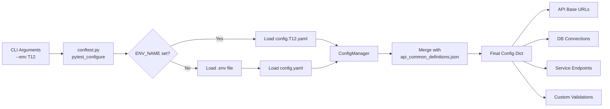

### 2. Test Case Loading & Filtering

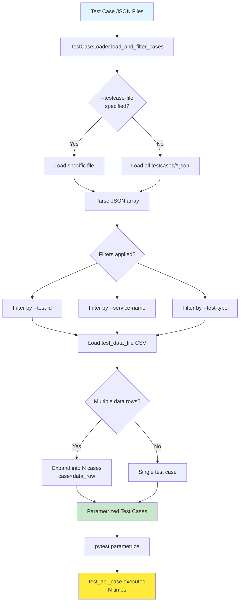

### 3. Context & Variable Management

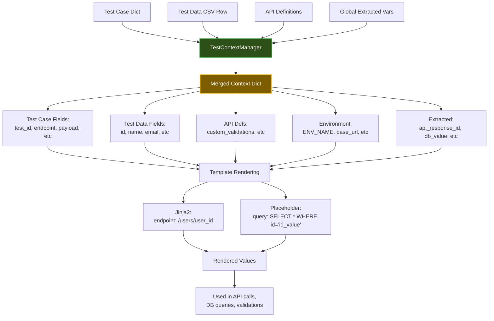

### 4. Client Management (Multi-Protocol)

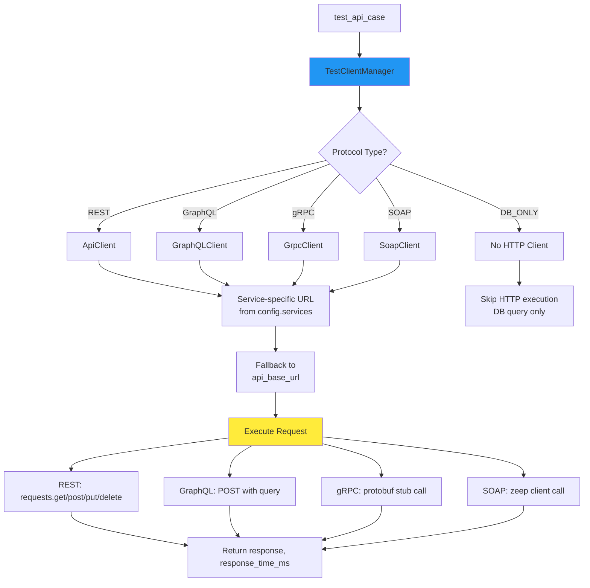

---

## Database Integration

### Database Query Flow

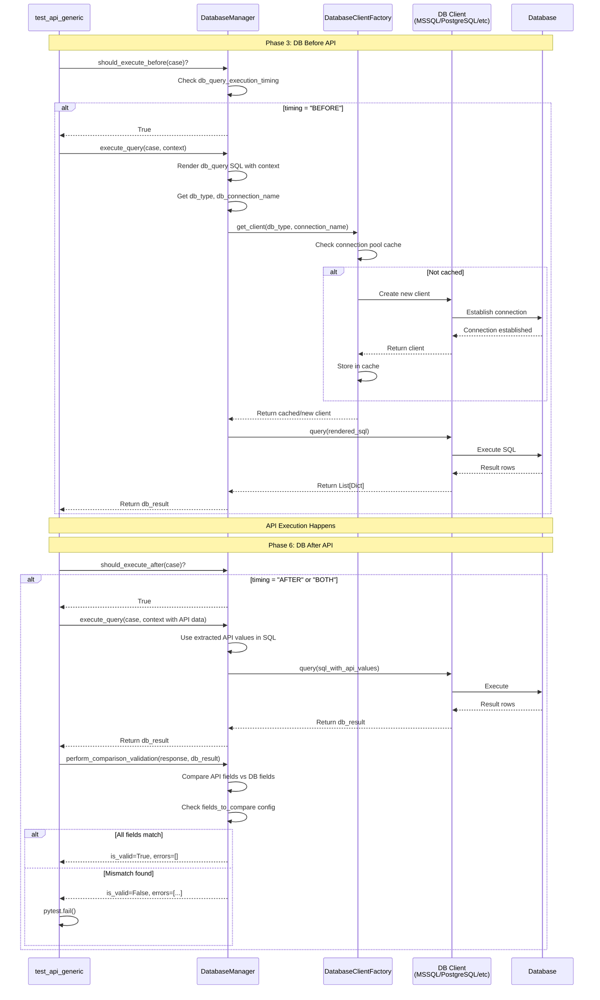

### Supported Databases

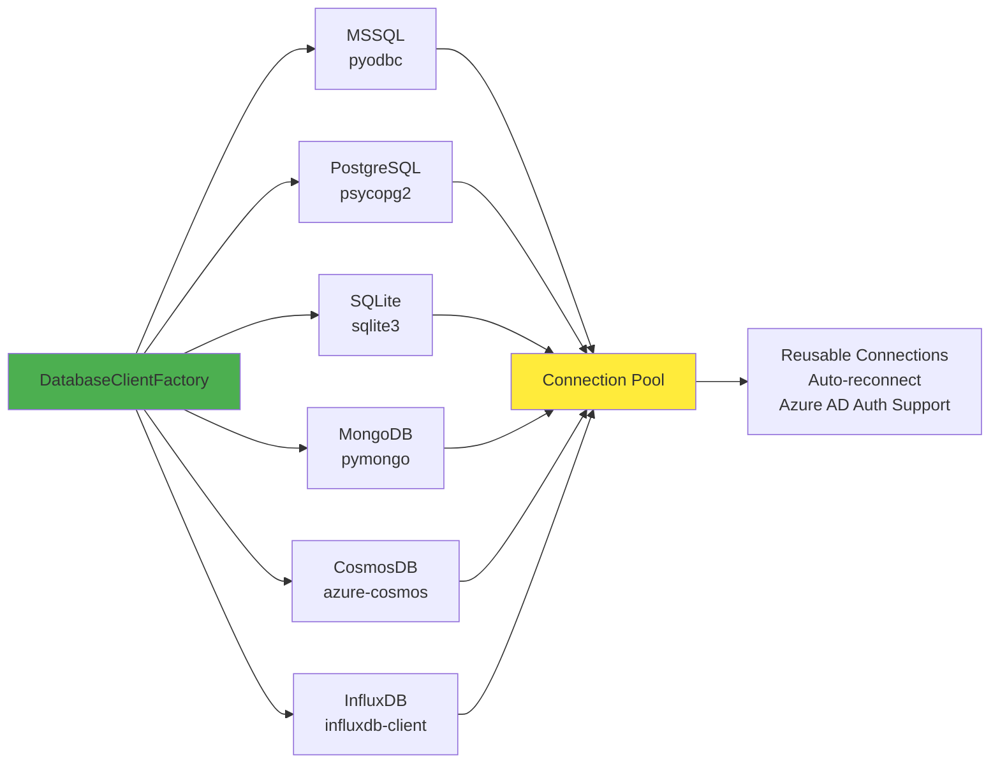

---

## Validation Pipeline

### Complete Validation Flow

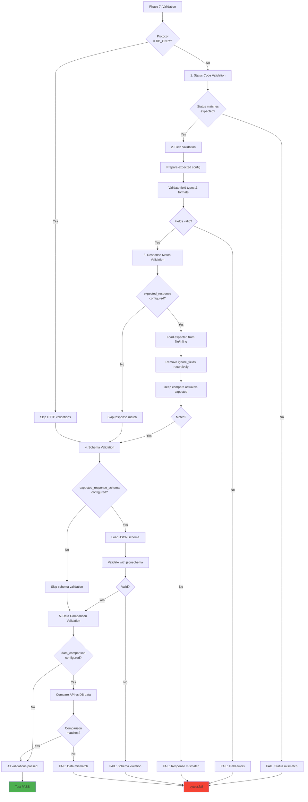

### Ignore Fields Mechanism

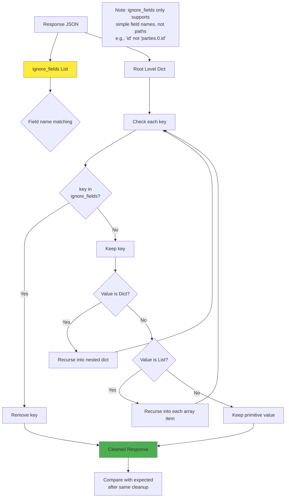

---

## Performance Testing (Locust)

### Locust Execution Flow

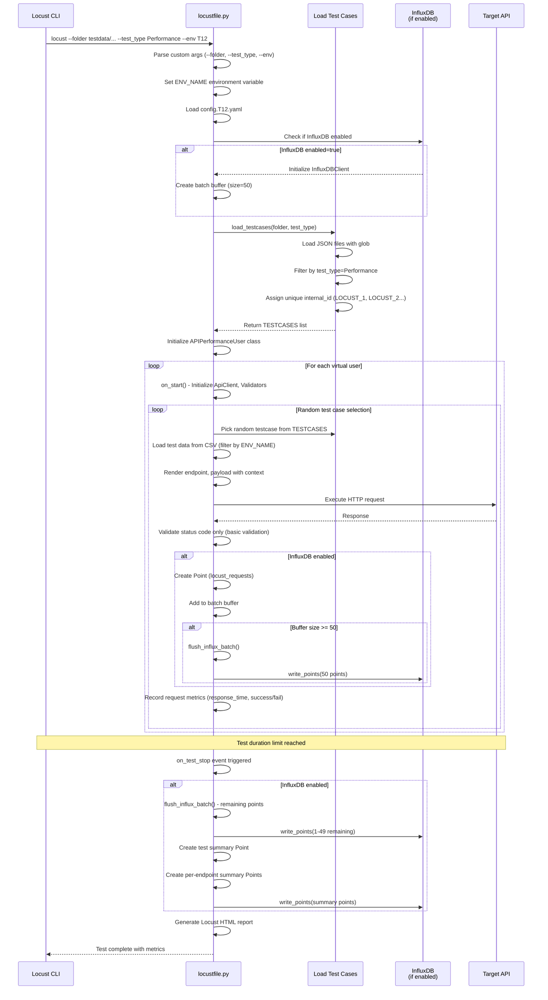

### InfluxDB Metrics Batching

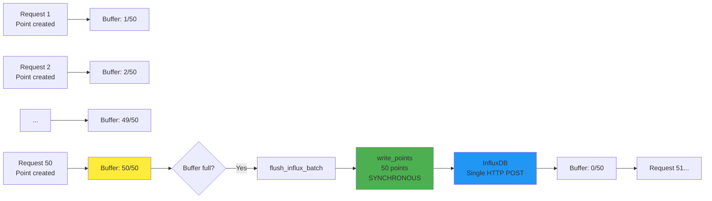

---

## File Structure

```
core-api-automation/
│
├── conftest.py                      # Pytest config, hooks, fixtures
├── pytest.ini                        # Pytest configuration
├── locustfile.py                     # Locust performance testing
├── .env                              # Environment variables (ENV_NAME, LOG_LEVEL)
│
├── config/
│   ├── config.yaml                   # Default configuration
│   ├── config.T12.yaml               # Environment-specific config
│   ├── config.TSADEV.yaml
│   └── config.aks.yaml
│
├── framework/
│   ├── api_common_definitions.json   # API definitions, custom validations
│   │
│   ├── loaders/
│   │   ├── config_loader.py          # ConfigManager - load configs
│   │   ├── testcase_loader.py        # Load test case JSON files
│   │   ├── testdata_loader.py        # Load CSV/JSON/YAML test data
│   │   └── api_definitions_loader.py # Load API definitions
│   │
│   ├── test_helpers/
│   │   ├── test_case_loader.py       # TestCaseLoader - pytest parametrization
│   │   ├── test_context_manager.py   # Context & variable management
│   │   ├── test_payload_manager.py   # Payload loading & rendering
│   │   ├── test_client_manager.py    # Multi-protocol client management
│   │   ├── test_db_manager.py        # Database query execution
│   │   ├── test_validation_manager.py# Orchestrate validations
│   │   └── test_result_collector.py  # Collect test results
│   │
│   ├── clients/
│   │   ├── api_client.py             # REST HTTP client
│   │   ├── graphql_client.py         # GraphQL client
│   │   ├── grpc_client.py            # gRPC client
│   │   ├── soap_client.py            # SOAP client
│   │   ├── db_client.py              # Database clients factory
│   │   └── azure_auth.py             # Azure AD authentication
│   │
│   ├── validators/
│   │   └── validators.py             # Validators class - all validations
│   │
│   ├── reporter/
│   │   ├── reporter.py               # HTML/JSON/JUnit report generation
│   │   └── influx_reporter.py        # InfluxDB metrics reporting
│   │
│   ├── common/
│   │   ├── logger.py                 # Centralized logging
│   │   ├── template_utils.py         # Jinja2 + placeholder rendering
│   │   ├── utils.py                  # Utility functions
│   │   └── common_functions.py       # Shared functions
│   │
│   └── runner.py                     # Direct test runner (non-pytest)
│
├── tests/
│   └── test_api_generic.py           # Main test file (8-phase execution)
│
├── testdata/
│   ├── <service_name>/
│   │   ├── testcases/
│   │   │   └── TestCase_*.json       # Test case definitions
│   │   ├── data_driven/
│   │   │   └── Data_*.csv            # Data-driven CSV files
│   │   ├── payloads/
│   │   │   └── Payload_*.json        # Expected response payloads
│   │   ├── schemas/
│   │   │   └── Schema_*.json         # JSON schemas
│   │   └── db_queries/
│   │       └── Query_*.sql           # SQL query files
│   └── ...
│
└── reports/
    └── YYYYMMDD_HHMMSS/
        ├── pytest_report_*.html      # HTML test report
        ├── json_report_*.json        # JSON test report
        ├── junit_report_*.xml        # JUnit XML report
        └── allure-results/           # Allure report data
```

---

## Quick Start Examples

### Example 1: Running Pytest Tests

```bash
# Run all tests for T12 environment
pytest tests/test_api_generic.py --env T12

# Run specific service tests
pytest tests/test_api_generic.py --env TSADEV --service-name parties

# Run specific test ID with custom test case file
pytest tests/test_api_generic.py --env T12 --test-id TC001 \
  --testcase-file testdata/WorkItemNotification/testcases/TestCase_api_workitemnotification_v1_aplid_GET.json

# Run performance tests only
pytest tests/test_api_generic.py --env T12 --test-type Performance
```

### Example 2: Running Locust Performance Tests

```bash
# Run performance test with 5 users for 30 seconds
locust --folder testdata/parties/testcases \
  --test_type Performance \
  --env TSADEV \
  --headless -u 5 -r 1 -t 30s

# Run with InfluxDB metrics (set enabled=true in config)
locust --folder testdata/WorkItemNotification/testcases \
  --test_type Performance \
  --env T12 \
  --headless -u 10 -r 2 -t 60s
```

### Example 3: Test Case JSON Structure

```json
{
  "test_id": "TC001",
  "service_name": "parties",
  "test_name": "GET /parties/{id}",
  "protocol": "REST",
  "test_type": ["Functional", "Performance"],
  "endpoint": "/parties/{{id}}",
  "method": "GET",
  "expected_status": "200",
  "expected_response_schema": "parties/schemas/Schema_party_success.json",
  "ignore_fields": ["partyId", "createdDate", "updatedDate"],
  "extract_values": [
    {
      "from": "api_response",
      "key": "parties.0.core.individual.dateOfBirth",
      "assign_to": "api_dob"
    }
  ],
  "validate": {
    "performance": {
      "max_response_time_ms": 500
    },
    "data_comparison": {
      "source": "api_response",
      "target": "db_result",
      "fields_to_compare": [
        {"source": "aplId", "target": "aplId"}
      ]
    }
  },
  "test_data_file": "parties/data_driven/Data_parties_GET.csv",
  "db_query": "parties/db_queries/Query_party_select.sql",
  "db_type": "mssql",
  "db_connection_name": "parties"
}
```

---

## Key Concepts for Beginners

### 1. **Data-Driven Testing**
- Test cases are defined in JSON files
- Test data is stored in CSV files
- Each data row creates a separate test execution
- Use `{{variable}}` placeholders that get replaced with data values

### 2. **Template Rendering**
- **Jinja2**: `{{user_id}}` - For complex expressions, loops, conditionals
- **Placeholder**: `%%user_id%%` - Simple string replacement
- Both support dot notation: `{{user.email}}`, `%%data.0.name%%`

### 3. **8-Phase Execution**
1. **Setup & Context**: Merge all variables
2. **Payload Loading**: Load and render request body
3. **DB Before API**: Optional DB query before API call
4. **API Execution**: Execute HTTP/gRPC/GraphQL/SOAP request
5. **Value Extraction**: Extract values for later use
6. **DB After API**: Optional DB query after API call (can use extracted values)
7. **Validation**: Status, fields, response match, schema, data comparison
8. **Result Collection**: Store results for reporting

### 4. **Multi-Protocol Support**
- **REST**: Standard HTTP GET/POST/PUT/DELETE
- **GraphQL**: POST with query/mutation in body
- **gRPC**: Protobuf-based RPC calls
- **SOAP**: XML-based web services
- **DB_ONLY**: Database query without API call

### 5. **Validation Types**
- **Status Code**: HTTP 200, 404, 500, etc.
- **Field Validation**: Check field types and formats
- **Response Match**: Compare actual vs expected response
- **Schema Validation**: Validate against JSON schema
- **Data Comparison**: Compare API response vs Database result

### 6. **Ignore Fields**
- List of field names to ignore during comparison
- Works recursively through nested objects and arrays
- Example: `["id", "timestamp", "createdDate"]`
- **Limitation**: Only simple field names, not paths like `"parties.0.id"`

### 7. **Database Integration**
- Supports MSSQL, PostgreSQL, SQLite, MongoDB, CosmosDB, InfluxDB
- Can execute queries BEFORE, AFTER, or BOTH relative to API call
- Extracted API values can be used in AFTER queries
- Data comparison validates API vs DB consistency

### 8. **Performance Testing**
- Uses Locust for load testing
- Filters test cases by `test_type=Performance`
- Supports concurrent users, ramp-up rates, duration limits
- Optional InfluxDB integration for real-time metrics
- Batches metrics (50 points) for efficiency

---

## Troubleshooting Guide

### Common Issues

1. **"Loaded 0 testcases" in Locust**
   - Check path separators (use `/` not `\` for Linux)
   - Verify `test_type` matches in test case JSON
   - Check if test cases have duplicate `test_id` values

2. **"Missing key in response"**
   - Check `ignore_fields` - may need to add field
   - Verify expected response JSON structure
   - Use `--log-cli-level=DEBUG` for detailed output

3. **Database connection failures**
   - Verify `db_connections` in config.yaml
   - Check `db_type` and `db_connection_name` in test case
   - Ensure database driver installed (pyodbc, psycopg2, etc.)

4. **Template rendering errors**
   - Check variable names match between CSV and test case
   - Verify dot notation paths (e.g., `parties.0.id`)
   - Use `{{variable}}` for Jinja2 or `%%variable%%` for placeholder

5. **Ignore fields not working for paths**
   - Current implementation doesn't support paths like `"parties.0.id"`
   - Use simple field name instead: `"id"` (ignores at all levels)
   - Enhancement needed for path-specific ignoring

---

## Next Steps

1. **Read test cases**: Review `testdata/*/testcases/TestCase_*.json` files
2. **Understand configuration**: Check `config/config.yaml` and environment-specific configs
3. **Run sample tests**: Start with simple GET requests
4. **Add new test cases**: Create JSON file following template
5. **Enable database validation**: Add `db_query` and `data_comparison` config
6. **Try performance testing**: Run Locust with Performance test types
7. **Customize validations**: Add custom validators in `api_common_definitions.json`

---

**Framework Version**: Latest (as of December 2025)
**Maintained by**: Automation Team
**Documentation**: This file + inline code comments
